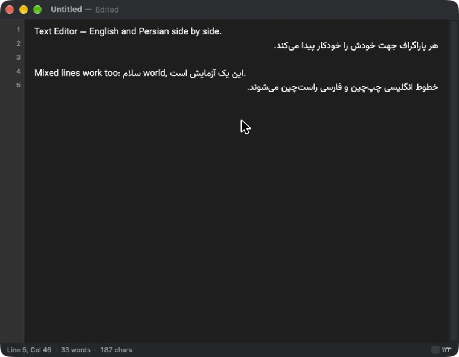

# Text Editor

[](https://github.com/muhshahabipour/text-editor/releases/latest)
[](LICENSE)


A native macOS plain-text editor (Swift + AppKit) with first-class Persian (RTL) and English (LTR) support, including mixed bidirectional text.

ویرایشگر متن بومی مک، با پشتیبانی کامل از فارسی و انگلیسی.



**[Project page](https://muhshahabipour.github.io/text-editor/)** · **[Download](https://github.com/muhshahabipour/text-editor/releases/latest)**

## What makes it different

- **Built for mixed Persian and English.** Every paragraph finds its own direction, so RTL and LTR lines sit correctly in the same file with no mode switching.
- **Persian-aware search.** Find and replace can treat ي/ی and ك/ک as the same letter, so text typed on Arabic keyboards is still found.
- **Old Persian files just work.** Windows-1256 files open correctly and are saved back in the same encoding, so nothing gets garbled.
- **Exports keep the direction.** HTML, RTF and PDF come out with Persian right-aligned and English left-aligned, not flattened to one direction.
- **Persian digits where you want them.** The status bar can show ۱۲۳ instead of 123.
- **Small and native.** A ~400 KB AppKit app with native tabs and system spell check. No Electron, no account, no cloud.
- **Plain text, no lock-in.** Your files stay ordinary `.txt` files.

## Install

1. Download `TextEditor-*-macOS.zip` from the [latest release](https://github.com/muhshahabipour/text-editor/releases/latest) and unzip it.
2. Move `TextEditor.app` to Applications.
3. The app is not notarized, so the first time right-click it and choose **Open**.

Apple Silicon, macOS 13 or later.

## Features and shortcuts

| Feature | How |
|---|---|
| Native tabs | `⌘T` |
| Direction per paragraph | Automatic. Force with `⌘⇧→` (LTR) / `⌘⇧←` (RTL) |
| Find | `⌘F`; Persian-aware find/replace `⌘⌥F` (ignores ي/ی and ك/ک differences) |
| Line numbers | On by default, toggle with `⌘⌥L` |
| Status bar | Line/column, words, characters; Latin digits by default, Persian digits optional |
| Theme | View → Theme: System / Light / Dark |
| Export As… | `⌘⇧E`: `.txt`, `.md`, `.html`, `.rtf`, `.pdf` (HTML, RTF and PDF keep per-paragraph direction) |
| Spell check | English and Persian |

## Notes

- Persian spell check needs Persian enabled in System Settings → Keyboard → Text Input → Spelling. This is a system setting, not an app one.
- Vazirmatn is used if installed, otherwise the system font.
- Files are read as UTF-8, then UTF-16 (with BOM), then Windows-1256. A file read as Windows-1256 is saved back in Windows-1256.
- Export leaves your document as plain text; it only writes a converted copy.

## Build from source

```bash
brew install xcodegen
xcodegen generate
xcodebuild -project TextEditor.xcodeproj -scheme TextEditor -configuration Debug -derivedDataPath build build
open build/Build/Products/Debug/TextEditor.app
```

Core logic tests: `cd EditorCore && swift test`

The text logic (statistics, Persian normalisation, encoding detection) lives in the `EditorCore` Swift package; the app is in `App/`. Design notes are in `docs/superpowers/`.

## Contributing

Contributions are welcome, especially Persian/RTL fixes. Read [CONTRIBUTING.md](CONTRIBUTING.md) for setup and guidelines, or open an [issue](https://github.com/muhshahabipour/text-editor/issues).

### Contributors

[](https://github.com/muhshahabipour/text-editor/graphs/contributors)

## License

See [LICENSE](LICENSE).
